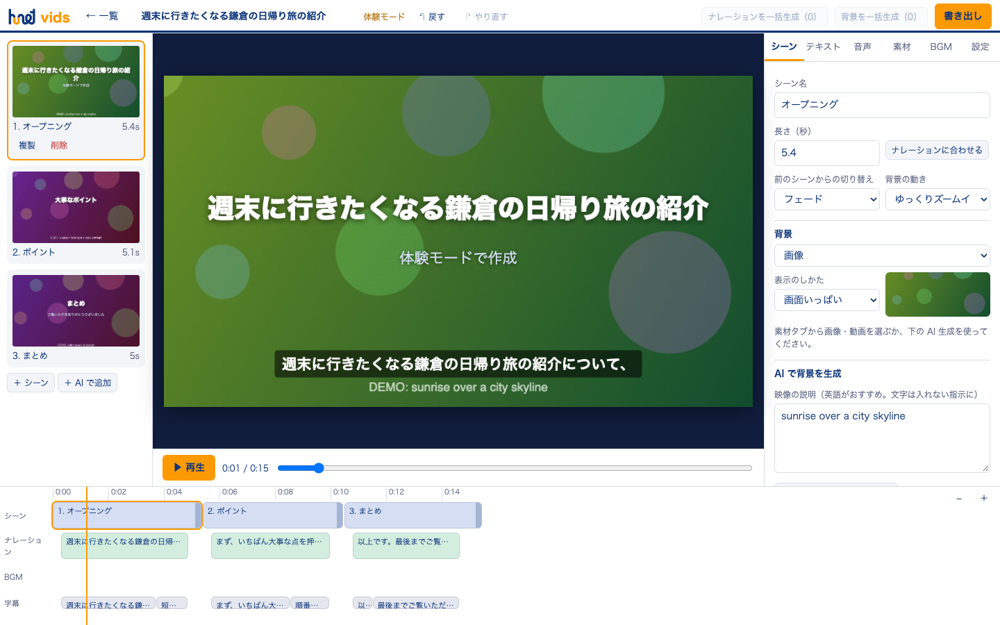

# hunet vids

[](https://github.com/TadFuji/hunet-vids/actions/workflows/ci.yml)
[](https://github.com/TadFuji/hunet-vids/actions/workflows/codeql.yml)

Google Vids のように、指示文から動画を作るブラウザアプリです。台本（絵コンテ）、ナレーション、背景の画像・動画、BGM を Gemini API で生成し、ブラウザの中で編集して MP4 に書き出します。利用者は各自の Gemini API キーを使います（BYOK）。サーバーは持たず、キー・動画・素材はその人のブラウザの中だけに保存されます。**書き出した動画に目に見える透かしは入りません。**

**公開アプリ:** https://hunet-vids.vercel.app ・ **図解取扱説明書:** [PDF](output/pdf/hunet_vids_図解取扱説明書.pdf) ・ **安全設計:** [docs/security.md](docs/security.md) ・ **検証記録:** [docs/validation.md](docs/validation.md)



## できること

| 分類 | 内容 |
|---|---|
| 作成 | 指示文と参考資料（貼り付け・.txt/.md）から、シーンごとの絵コンテを作成。長さ（15 秒〜5 分）、画面の形（16:9・9:16・1:1）、テーマ、声、言語を指定 |
| AI 生成 | ナレーション（30 種の声、話し方の指示、文章の書き換え）、背景画像（Nano Banana）と指示による画像編集、音声つき動画（Gemini Omni、画像を動かす機能つき）、人物がセリフを話す動画（アバター風）、BGM（Lyria、30 秒ループ／2〜3 分の曲） |
| 編集 | シーンの追加・複製・並べ替え、テキスト（見出し・本文・ラベル・テロップ、登場アニメーション、プレビュー上でドラッグ移動）、切り替え効果、背景のズーム・パン、タイムライン（ドラッグで長さ変更）、元に戻す／やり直す |
| 音声 | ナレーションに合わせたシーンの長さ調整、BGM の音量・フェード、ナレーション中の BGM 自動音量調整 |
| 字幕 | ナレーションから自動作成（位置・色・帯・大きさ）、.srt で保存 |
| 素材 | 画像・動画・音声のアップロード、カメラ・画面・画面＋カメラの録画（原稿を表示するプロンプターつき） |
| 書き出し | MP4（1080p／720p、24・30・60fps）。ブラウザ内で処理し、どこにもアップロードしません |
| 保存 | ブラウザ内に自動保存。素材ごと 1 つのファイル（.hunetvids）に保存・読み込み（旧 .myvids も可） |
| 体験モード | API キーなしで全操作を試せます（AI の代わりに仮の素材を作ります。費用なし） |

未対応: Google スライドからの変換、ストック素材集、共同編集、YouTube への直接公開、GIF 書き出し。Google Vids との比較は [docs/research.md](docs/research.md) にあります。

## 使い始める

### 公開版

1. https://hunet-vids.vercel.app を Chrome または Edge で開きます。
2. [Google AI Studio](https://aistudio.google.com/apikey) で作った API キーを入れて「確認して保存」を押します。キーなしで試すときは「キーなしで体験する」を押します。
3. 「どんな動画を作りますか？」に内容を書いて「AI で絵コンテを作成」を押します。
4. 編集画面で調整し、右上の「書き出し」から MP4 を保存します。スペースキーで再生／停止できます。

### 自分のパソコンで動かす

Finder で `hunet vidsを起動.command` をダブルクリックすると、ビルドして http://127.0.0.1:4180/ を開きます。終了するときは、そのウィンドウで `Ctrl + C` を押します。ターミナルから行う場合は次のとおりです（Node.js 22.12 以上）。

```bash
npm ci --ignore-scripts
npm run build
npm start
```

動作確認は Chrome と Chromium で行っています。Safari では MP4 の書き出しができない場合があります。

## 費用の目安

2026-10-13 時点の Google の公開価格です。実際の請求は AI Studio で確認してください。

| 生成 | 目安 | 無料枠 |
|---|---|---|
| 台本・文章の書き換え | ごく少額 | あり |
| ナレーション | ごく少額 | あり |
| 画像（2K） | 1 枚 約 $0.05 | なし |
| 動画（720p） | 1 秒 約 $0.10（8 秒で約 $0.80） | なし |
| BGM | 30 秒 $0.04 ／ 1 曲 $0.08 | なし |

画像・動画・BGM には、AI Studio で課金（Billing）の設定が必要です。生成ボタンには費用の目安を表示し、まとめて生成する前には確認を求めます。

## キーと作品の扱い

- API キーはこのブラウザの保存領域（localStorage）に保存し、Gemini API（`generativelanguage.googleapis.com`）へ `x-goog-api-key` ヘッダーとしてだけ送ります。設定画面の「キーを削除」で消せます。共有のパソコンでは使い終わったら削除してください。
- 公開サイトは、通信できる外部の宛先を Gemini API だけに制限しています（Content-Security-Policy）。
- 動画・素材・プロジェクトはブラウザの IndexedDB に保存され、どこにもアップロードされません。ブラウザのサイトデータを消すと消えるため、大事なプロジェクトは一覧画面の「ファイルに保存」でバックアップしてください。
- 生成した素材には、Google の目に見えない電子透かし（SynthID）が含まれます。

詳しい境界と残るリスクは [docs/security.md](docs/security.md) を参照してください。

## 開発と検証

```bash
npm run check      # 型チェック・ビルド、単体テスト、文書のリンク検査
npm run test:e2e   # 本番ビルドに対するブラウザテスト（Playwright）
```

**自動テストは実 API キーや有料生成を使いません。** Google との通信は、テスト内ですべて偽の応答に置き換えます。実 API での確認は `npm run test:live` で別に行い、結果は [docs/validation.md](docs/validation.md) に区別して記録します。構成は [docs/architecture.md](docs/architecture.md)、開発手順は [docs/development.md](docs/development.md)、公開手順は [docs/deployment.md](docs/deployment.md) にあります。

## 資料と参加

- 不具合・提案: [Issues](https://github.com/TadFuji/hunet-vids/issues)（[貢献について](CONTRIBUTING.md)）
- セキュリティ上の問題: [SECURITY.md](SECURITY.md)（非公開で報告してください）
- 変更履歴: [CHANGELOG.md](CHANGELOG.md)

この公開リポジトリには現在 `LICENSE` がありません。閲覧できることを、コード・画像の再利用、改変、再配布の許可と解釈しないでください。
