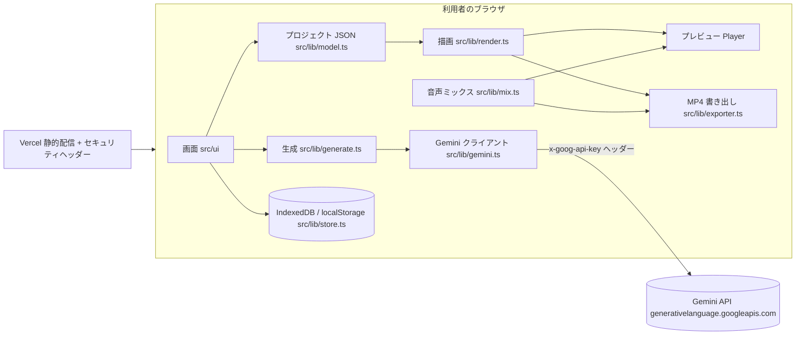

# 構成

hunet vids はサーバーを持たない静的なウェブアプリです。React 19 + TypeScript + Vite で作り、実行時の外部ライブラリは React と [mediabunny](https://mediabunny.dev/)（WebCodecs による MP4 の読み書き）だけです。

## データの流れ

1. **作成:** 指示文 → `storyboard.ts` が Gemini（`gemini-3.8-flash`、JSON スキーマ指定）で絵コンテを作り、`cleanStoryboard()` で全項目を補正してからプロジェクトに変換します。
2. **生成:** `generate.ts` が素材を作って IndexedDB に保存し、「シーンをどう変えるか」という更新関数を返します。編集画面はそれを最新のプロジェクトに適用します（生成中に編集されても上書きしないため）。生成はラベルではなくシーン ID ごとのキーで重複を防ぎ、同時実行は 2 件までです（`Editor.runJob`）。
3. **描画:** `render.ts` の `drawFrame()` が 1 コマを Canvas に描きます。プレビューと書き出しは同じ関数を使うので、見た目が一致します。背景動画の時刻（切り出し・繰り返し）は `videoMediaTime()` 1 か所で計算します。
4. **音声:** `mix.ts` がナレーション・背景動画の音・BGM（フェード、ナレーション中の音量調整）を Web Audio で予約します。プレビューは `AudioContext`、書き出しは `OfflineAudioContext` を使います。
5. **書き出し:** `exporter.ts` がコマごとに描画して H.264、音声を AAC で符号化し、MP4 にまとめます（mediabunny）。動画素材は `CanvasSink` でコマ単位に正確に読み出します。

## Gemini API の使い方

すべて Interactions API（`POST /v1beta/interactions`）です。モデル ID は `src/lib/gemini.ts` の `MODELS` 1 か所にまとめています。

| 用途 | モデル | 備考 |
|---|---|---|
| 絵コンテ・書き換え | `gemini-3.8-flash` | `response_format` で JSON スキーマ |
| ナレーション | `gemini-3.8-flash-tts` | WAV で受け取る |
| 画像・画像編集 | `gemini-nano-banana-2.1` | 2K、参照画像つき編集 |
| 動画・人物動画 | `gemini-omni-1.1-flash` | 16:9 / 9:16、`delivery: "uri"` で受け取り Files API から取得 |
| BGM | `lyria-3-clip-preview` / `lyria-3.5` | 30 秒 / 曲 |
| 予備（将来拡張用） | `gemini-3.8-flash-lite` / `gemini-nano-banana-lite-1.1` / `gemini-speech-1.1` | `MODELS` に定義（軽量テキスト・軽量画像・文字起こし用） |

時間のかかる生成は `background: true` で依頼して `GET /v1beta/interactions/{id}` を待ちます。中止すると `POST /v1beta/interactions/{id}/cancel` で Google 側の生成も取り消します。詳細と未確認点は [セキュリティ設計](security.md) と [検証記録](validation.md) を参照してください。

## コードの場所

| 場所 | 役割 |
|---|---|
| `src/lib/model.ts` | プロジェクトの型、テーマ、外部ファイル由来のデータを補正する `normalizeProject()` |
| `src/lib/timeline.ts` | シーンの時刻、字幕の分割と時刻、SRT |
| `src/lib/render.ts` | 描画（切り替え効果、ズーム・パン、文字アニメーション、字幕） |
| `src/lib/media.ts` | プレビュー用・書き出し用の素材読み込み |
| `src/lib/mix.ts` / `audio.ts` | 音声の予約とミックス、WAV |
| `src/lib/exporter.ts` | MP4 書き出し |
| `src/lib/gemini.ts` | Gemini クライアント（取得先の制限、取り消し、エラー文） |
| `src/lib/mock.ts` | 体験モード（API の代わりに仮の素材を作る） |
| `src/lib/storyboard.ts` / `generate.ts` | 絵コンテ、各種生成 |
| `src/lib/store.ts` / `backup.ts` | 保存、`.hunetvids` ファイル |
| `src/ui/` | 画面（設定、一覧、編集、タイムライン、録画、書き出し） |
| `server.mjs` | `dist/` を本番と同じヘッダーで配信する確認用サーバー |
| `vercel.json` | 公開時のビルド設定とセキュリティヘッダー |
| `tests/` | ブラウザテスト（Playwright） |
| `src/**/*.test.ts`, `scripts/*.test.mjs` | 単体テスト（Vitest） |

ブラウザ内の保存名（IndexedDB の `my-vids`、localStorage の `my-vids.*`、保存ファイル先頭の `MYVIDS1`）は、名称変更前のデータを読み続けるため旧名のままです。
