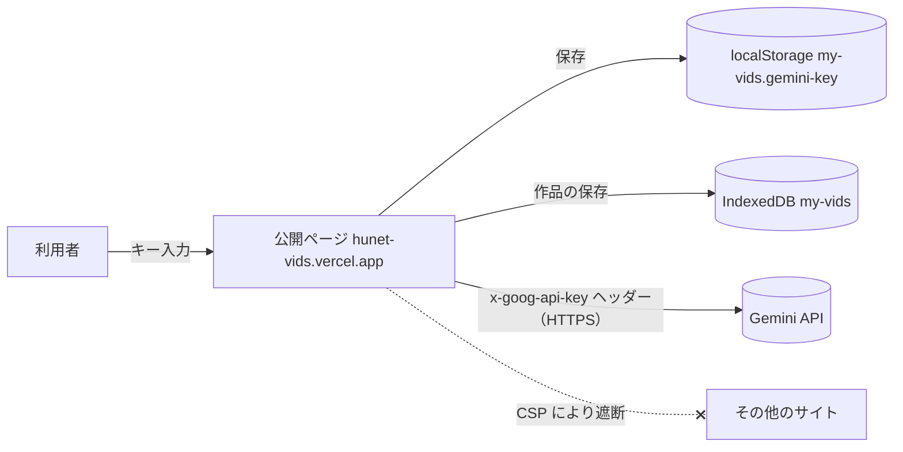

# セキュリティ設計

この文書は、hunet vids が利用者の API キーと作品をどう扱い、何を守り、何を守れないかを説明します。

## 守る対象

- 利用者の Gemini API キー（漏れると、その人の課金で生成される）
- 利用者の動画・音声・画像・プロジェクト
- 利用者の課金（意図しない有料生成の重複や継続）

## データの経路

運営者（このサイトの提供者）のサーバーはありません。キーと作品は運営者に送られません。

## 対策

| 対象 | 対策 | 場所 / テスト |
|---|---|---|
| キーの送信先 | `fetch` の宛先は固定の `https://generativelanguage.googleapis.com/v1beta` のみ。キーは `x-goog-api-key` ヘッダーで送り、URL・本文には入れない | `src/lib/gemini.ts` / `tests/api-key.spec.ts`, `src/lib/gemini.test.ts` |
| 応答に含まれる取得先 | 生成結果の `uri` は `files/...`（同じ Google のホスト）に限って取得し、それ以外にはキーを送らずに中止 | `Gemini.download` / `gemini.test.ts` |
| 通信先の制限 | Content-Security-Policy の `connect-src` を自サイトと Gemini API（ほかにブラウザ内の `blob:`・`data:`）に限定。スクリプトは自サイトのファイルだけ（インラインや外部 CDN なし）。スタイルは画面部品のためインライン指定を許可（`style-src 'unsafe-inline'`） | `vercel.json` / `tests/headers.spec.ts`, `scripts/vercel-config.test.mjs` |
| 埋め込み・その他 | `frame-ancestors 'none'`、`object-src 'none'`、`form-action 'none'`、`X-Content-Type-Options: nosniff`。加えて `X-Frame-Options: DENY`、`base-uri 'none'`、`Cross-Origin-Opener-Policy: same-origin`、HSTS（※） | `vercel.json` |
| ブラウザ機能 | `Permissions-Policy` でカメラ・マイク・画面共有は自サイトのみ（録画機能のため）、位置情報は無効。決済も無効（※） | `vercel.json` |
| 表示 | AI の出力や読み込んだファイルの文字は React のテキストと Canvas にだけ描き、HTML として解釈しない（`innerHTML` 等を使わない） | `src/` 全体 |
| 保存ファイルの読み込み | `.hunetvids` は信用しない入力として扱い、サイズと位置を検査し、全項目を補正してから保存。壊れていれば何も書き込まずに拒否 | `src/lib/backup.ts`, `normalizeProject()` / `hardening.test.ts`, `tests/demo.spec.ts` |
| エラー表示 | Google のエラーを日本語の対処法に置き換えて表示。キーはエラー文に含まれない | `explainError()` / `tests/api-key.spec.ts` |
| 課金 | 生成ボタンに費用の目安、まとめて生成する前に確認。同じ生成の二重実行を防止、同時実行は 2 件まで。中止時は Google 側の生成も取り消す | `src/ui/Editor.tsx`, `gemini.ts` / `gemini.test.ts` |
| リポジトリ | CI で全履歴の秘密情報検査（gitleaks）、CodeQL、依存関係の脆弱性検査、Dependabot | `.github/` |

※ 2026-10-13 時点では、リポジトリの `vercel.json` には含まれていますが、公開サイトへの反映は次回の公開で行われます。反映状況は [公開記録](deployment.md) を参照してください。

## 残るリスク（守れないもの）

- **キーはブラウザに保存されます。** 同じサイト上で悪意あるスクリプトが動いた場合（配信の改ざん、ブラウザ拡張機能、開発者ツール、乗っ取られたパソコン）は読み取られる可能性があります。CSP により、その場合でも外部サイトへの送信は制限されますが、Gemini API そのものを不正に使われることは防げません。共有のパソコンでは使い終わったらキーを削除してください。
  - 参考: 姉妹アプリ [hunet-banana](https://github.com/TadFuji/hunet-banana) は、キーを専用 Worker の一時メモリにだけ置き、タブを閉じると破棄する方式です。hunet vids は「最初にキーを入れれば次回も使える」ことを優先して保存方式にしています。保存しない方式への変更は今後の検討事項です。
- 体験モード以外の生成は、利用者のキーで Google に依頼されます。生成された内容と料金は利用者と Google の間のものです。
- このアプリは Google の応答（生成物）の安全性を保証しません。
- 「絶対に漏れない」ことは保証しません。

## 利用者側でできる設定

- **キーの用途を絞る:** AI Studio（Google Cloud）のキー設定で、使える API を「Generative Language API」に限定できます。
- **ウェブサイトの制限:** 従来型の API キーでは「HTTP リファラー」制限に `https://hunet-vids.vercel.app/*` を指定できます。hunet vids は `Referrer-Policy: strict-origin-when-cross-origin` を送るので、この制限と両立します。ただし、新しい種類のキーではリファラー制限を使えない場合があり、実際のキーで動作を確認していません（[検証記録](validation.md)）。
- **予算の上限:** Google Cloud の予算アラートを設定すると、想定外の請求に気づけます。

## 問題の報告

[SECURITY.md](../SECURITY.md) を参照してください。
